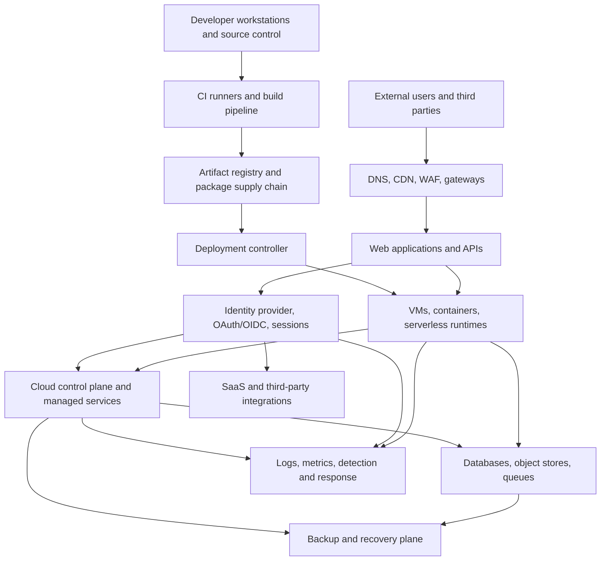

# Modern Software Infrastructure: Adversary-First Exploitability Playbook

**Research date:** 25 October 2026  
**Audience:** security engineers, penetration testers, red teams, threat hunters, infrastructure architects  
**Purpose:** analyze modern infrastructure from an adversary's economic and technical perspective, rank exploit opportunities, and turn that analysis into repeatable assessment work.

> **Operating premise:** an adversary does not care how an organization divided its teams, products, cloud accounts, or security tools. They care which reachable weakness provides the cheapest path to a valuable outcome, what authority that foothold inherits, what other trust boundaries it can cross, and how much time defenders have to intervene.

This playbook describes attack surfaces, exploit classes, hypothetical attack-path logic, prioritization, and concrete validation methods. It does not treat a vulnerability score as proof of exploitability or invent findings for an environment that has not been examined. Target-specific intrusive testing requires a defined scope and evidence; without that, paths below are models, not claims of compromise.

---

## 1. Executive assessment

Modern infrastructure is best understood as a graph of identities, software, runtime contexts, control planes, data stores, and external dependencies. The public application is only one entry point. A more consequential weakness often appears at an interface between layers: application code that inherits a cloud identity; an OAuth grant that crosses into SaaS; a build runner with production deployment rights; a container with broad service permissions; or an administrator who can alter both production and its recovery system.

The security question is not just “Does this component have a vulnerability?” It is:

1. Can the weakness be reached from a realistic starting condition?
2. What authority does successful exploitation actually grant?
3. Which next trust boundary becomes reachable?
4. What valuable outcome can follow from the chain?
5. Which assumptions are proved, inferred, or unknown?
6. Which single control change breaks the most important paths?

The evidence supports prioritizing these relationships. OWASP Top 10:2025 ranks Broken Access Control first, Security Misconfiguration second, and Software Supply Chain Failures third. Verizon's 2026 DBIR page reports that 31% of breaches start with software vulnerabilities and 48% involve ransomware. Microsoft's September 2026 cloud-web-applications threat matrix explicitly connects application execution contexts, identities, deployment pipelines, and connected cloud resources. These are different sources and different populations; they support a cross-layer assessment model rather than a universal prediction about any one organization.

**Working verdict:** inventory and patching remain necessary, but the strongest assessment signal comes from a reachable, evidence-supported chain that crosses a trust boundary and ends in material business impact.

## 2. Modern infrastructure: the actual attack surface

### 2.1 Reference architecture



The diagram represents common relationships, not a required topology. Real deployments are distributed, asynchronous, and sometimes managed by several providers. The key is to document the trust and authority carried across every connection.

### 2.2 Layers and the adversarial question

| Layer | Typical components | Adversary's question | Failure modes to examine |
|---|---|---|---|
| Public edge | DNS, CDN, WAF, reverse proxy, VPN, gateways | What can be reached before identity is proven? | Forgotten endpoints, exposed admin surfaces, stale services, weak routing boundaries |
| Application/API | Web apps, REST/GraphQL/gRPC, background jobs | Does a requester's identity actually constrain each operation and object? | Broken object/function/property authorization, injection, unsafe parsing, SSRF, workflow bypass |
| Identity | SSO, MFA, OAuth/OIDC, SAML, service principals, workload identities | Which identity can obtain which session, token, role, or delegated permission? | Overprivilege, weak recovery paths, excessive token lifetime, broad app consent, unsafe federation |
| Runtime | VMs, containers, serverless, functions | What authority and network reach does code inherit when it runs? | Overprivileged runtime identities, weak isolation, exposed metadata, writable runtime, vulnerable base images |
| Cloud control plane | IAM, management APIs, projects/accounts/subscriptions, policies | Can an application or user identity create, change, or expose important resources? | Excessive roles, unsafe trust policies, weak separation of duties, publicly exposed management |
| Delivery chain | Source control, CI runners, registries, IaC, deployment systems | Can changing source or build inputs change production without an independent control? | Secret leakage, untrusted build execution, dependency confusion, artifact provenance gaps, reusable credentials |
| Data plane | Databases, object storage, caches, queues, search indexes | Which identity can read, alter, export or delete high-value records? | Public storage, broad data roles, shared credentials, poor tenant isolation, inadequate auditability |
| Observability | Cloud audit logs, EDR, SIEM, metrics, alert pipelines | Would a meaningful path create timely, attributable evidence? | Missing sources, weak correlations, blind spots, mutable logs, ineffective alert routing |
| Recovery | Snapshots, backup vaults, restore accounts, offline copies | Can the same compromised authority damage production and recovery? | Shared admin plane, reachable backups, untested restore, compromised keys, retention gaps |
| Third parties | SaaS, vendors, APIs, managed build services | What trust does a supplier or integration inherit? | Broad OAuth grants, vendor access that persists, weak isolation, unreviewed service dependencies |

### 2.3 Trust boundaries that deserve first attention

A trust boundary is a point where identity, privilege, network reach, data sensitivity, or control authority changes. Focus on boundaries such as:

- anonymous internet request → authenticated application session;
- ordinary user → tenant or object owner;
- application process → cloud workload identity;
- workload identity → cloud control plane;
- developer change → trusted build artifact;
- CI runner → production deploy permission;
- Kubernetes workload → node or cluster administration;
- SaaS integration → tenant-wide application consent;
- production administrator → backup administrator;
- monitored activity → an event pipeline that must stay available during an incident.

A large number of isolated low-severity observations is less informative than one verified edge that lets low-trust authority cross a high-impact boundary.

---

## 3. Adversary economics: what makes an exploit valuable?

An adversary prioritizes outcomes, not CVE numbering. The same vulnerability can be low-value in an isolated disposable host and severe in a public application whose runtime identity has read access to regulated data and write access to production configuration.

### 3.1 Exploit-opportunity model

Score each dimension from 0 to 5. Record the reason and evidence for each score; don't use numbers as decoration.

| Factor | Weight | Questions |
|---|---:|---|
| Business impact (I) | 25% | Would the outcome expose regulated data, permit fraud, interrupt a critical service, or compromise control of a major environment? |
| Reachability (R) | 15% | Is the entry point public, broadly accessible, or dependent on several uncommon preconditions? |
| Exploit maturity (E) | 15% | Is exploitation confirmed in the wild, a reliable vendor-supported test, a known vulnerable configuration, or merely theoretical? |
| Authority gain (A) | 15% | Does success provide code execution, data access, a new identity, broader role, or control-plane authority? |
| Path breadth (B) | 10% | How many important assets or subsequent trust transitions become reachable? |
| Control gap (G) | 10% | Is a primary preventive control absent, ineffective, or bypassable? |
| Detection/recovery asymmetry (D) | 10% | Would meaningful activity evade useful monitoring, or could the impact outlast recovery capabilities? |

Use this normalized triage index:

\[
P = 20(0.25I + 0.15R + 0.15E + 0.15A + 0.10B + 0.10G + 0.10D)
\]

`P` falls between 0 and 100. The weights are a starting point for triage, not an empirically calibrated breach-probability model. Keep confidence as a separate field. A high-consequence theoretical chain with weak evidence should result in a high-priority validation task—not an assertion that exploitation is proven.

### 3.2 Exploit maturity scale

| Score | State | Evidence expected |
|---:|---|---|
| 0 | Not applicable | Product/version/configuration is not affected or relevant |
| 1 | Speculative | Plausible weakness, no direct evidence of a working vulnerability in the asset |
| 2 | Configuration or design concern | An unsafe setting or control gap is directly observed; exploitability remains unproven |
| 3 | Reproducible non-destructive validation | A controlled check demonstrates the vulnerability condition without harmful impact |
| 4 | Reliable, independently validated vulnerability | Strong evidence that documented preconditions hold and the weakness behaves as expected |
| 5 | Exploitation observed in credible threat reporting or confirmed in the tested environment | Current, asset-relevant evidence, with context and source recorded |

Do not award a 5 solely because a CVE has public proof-of-concept code. Confirm the actual product, version, configuration, exposure, preconditions, mitigation status and evidence freshness.

### 3.3 Risk overrides

The weighted index must not hide specific urgent cases. Flag an item for immediate expert review when any of the following is true:

- The vulnerability is listed in CISA's Known Exploited Vulnerabilities Catalog and the asset is exposed and affected.
- The path grants high-impact control-plane privileges or access to sensitive production data.
- A confirmed authorization failure crosses tenant boundaries.
- Production and recovery can both be materially affected by the same administrative compromise.
- A critical trust edge is actively exploited or is part of a known incident.

CISA's September 2026 KEV guidance emphasizes prioritizing remediation according to risk, particularly for exposed assets where exploitation grants total control, and considering whether compromise occurred before the fix was applied. Use that logic as a prioritization input, not as a substitute for contextual analysis. [CISA KEV notice, 8 September 2026](https://content.govdelivery.com/accounts/USDHSCISA/bulletins/428fa64).

### 3.4 Two rankings, not one

Maintain separate queues:

1. **Adversary opportunity ranking:** models impact, reachability, exploit maturity, authority gain, path breadth, control gap and detection/recovery asymmetry.
2. **Defensive action ranking:** combines risk, confidence, exposure, remediation effort, operational risk, control coverage and due date.

The two queues are related but not identical. An assessment may prioritize validating a high-impact unknown edge before spending time on a well-understood but isolated medium-severity flaw.

---

## 4. Exploit classes and how they apply

This section explains the relationship between common exploit classes and modern architecture. It describes prerequisites, likely leverage, safe validation evidence and high-value controls. It is not a payload cookbook.

### 4.1 Public-facing application flaws

**Where they apply:** internet-facing applications, administrative portals, API gateways, VPN services, managed web runtimes and exposed appliances.

**Why an adversary values them:** they can provide an initial foothold without an existing organizational identity. The resulting authority is determined by the vulnerable process and its reachable resources—not by the headline vulnerability alone.

**Conditions that increase priority:** the affected version is actually present; vulnerable code is reachable; configuration supports the flaw; the service has useful runtime permissions; the host or workload can access sensitive services; mitigations are absent or ineffective.

**Assessment questions:** Is the affected build deployed? Is the vulnerable endpoint enabled? Does the process have an attached workload identity or sensitive configuration? Can the behavior be reproduced safely against a disposable lab instance or a vendor-supported non-destructive check? Are there logs and a tested patch path?

**Typical failure outcomes:** unauthorized data access, unintended server-side actions, code execution under the service context, or denial of service. A path to control-plane access requires additional evidence; do not assume that web code execution automatically equals cloud-admin control.

**Relevant mapping:** MITRE ATT&CK's [Enterprise and Cloud matrices](https://attack.mitre.org/matrices/enterprise/cloud/); OWASP Top 10:2025 [Security Misconfiguration](https://top10.owasp.org/2025/A02_2025-Security_Misconfiguration/) and relevant injection/access-control categories.

### 4.2 Authentication, session and token failures

**Where they apply:** identity providers, SSO federation, OAuth/OIDC clients, API tokens, machine identities, password recovery and session management.

**Why an adversary values them:** a valid identity can bypass perimeter assumptions and inherit legitimate permissions. Tokens and federation links can cross boundaries that network topology does not reveal.

**Conditions that increase priority:** privileged or cross-tenant scope; weak token validation or lifecycle handling; excessive delegated permissions; stale service credentials; recoverability flaws; weak separation between human and workload identity; inability to revoke sessions promptly.

**Assessment questions:** Which issuer, audience, tenant, subject and scopes does a token represent? Which identity can consent to applications? Are signing keys and issuer metadata validated? How do logout, revocation and emergency access work? Are token use and privilege changes observable?

**Typical failure outcomes:** unauthorized sessions, impersonation of an existing principal, or access outside the intended role or tenant. Validate token-handling behavior using a test tenant and synthetic users; never use captured credentials from a real person as test material.

**Current reference:** NIST IR 8587, published September 2026, addresses token and assertion forgery, theft and misuse in SSO, federation and API access scenarios: [NIST IR 8587](https://csrc.nist.gov/pubs/ir/8587/final).

### 4.3 Broken application and API authorization

**Where they apply:** REST, GraphQL, gRPC, internal APIs, object stores accessed through an API, multi-tenant SaaS and administrative workflows.

**Why an adversary values them:** a valid low-privilege account can become a route to another user's data or a function it should never be allowed to invoke. The entry condition can be modest while the business impact is high.

**Core test families:**

- **Object-level authorization:** the server checks access to the specific object on every request.
- **Function-level authorization:** the server enforces role requirements for privileged actions.
- **Property-level authorization:** writable and readable fields are constrained by policy.
- **Tenant isolation:** tenant identity is derived and enforced server-side rather than trusted from a client-supplied identifier.
- **Business workflow:** approval states, quotas, ownership and transaction rules cannot be bypassed by changing request order or repeating an operation.
- **API inventory:** undocumented and deprecated interfaces are accounted for and controlled.

**Validation method:** create two synthetic users and, where applicable, two synthetic tenants. Create records owned by each. Verify that authorization checks deny cross-owner and cross-tenant operations for both read and write actions. Record status, relevant response fields, request identifiers and expected policy. Never retrieve live third-party records merely to prove a defect.

**Current mapping:** OWASP API Security Top 10:2023 includes Broken Object Level Authorization, Broken Authentication, Broken Object Property Level Authorization, Broken Function Level Authorization, SSRF, Security Misconfiguration, Improper Inventory Management and Unsafe Consumption of APIs. See the [official project](https://owasp.org/www-project-api-security/).

### 4.4 Injection and unsafe processing

**Where they apply:** databases, search backends, template engines, operating-system command boundaries, expression languages, document parsers, deserializers and message consumers.

**Why an adversary values them:** data that crosses an unsafe interpreter boundary can be treated as instructions. The impact depends on the interpreter, the process authority, the reachable backend and any secondary trust relationship.

**Conditions that increase priority:** untrusted values reach an interpreter; unsafe construction or parsing is confirmed; the vulnerable operation is reachable; the process has sensitive permissions; or the flaw can expose another service across a trust boundary.

**Assessment questions:** Is the input path reachable? Does the application use parameterized queries or safe APIs? Can the problem be reproduced using a non-destructive marker or a dedicated lab fixture? What is the process context and data-access authority? Are errors and suspicious behavior logged?

**Typical failure outcomes:** data disclosure or mutation, server-side request behavior, unauthorized computation, or availability impact. Determine the precise outcome in an isolated fixture; do not infer arbitrary code execution from every injection finding.

### 4.5 Server-side request forgery and trust-boundary confusion

**Where they apply:** URL previewers, webhook delivery, document converters, importers, image processors, fetch proxies, cloud-hosted application runtimes and integrations that make outbound requests.

**Why an adversary values them:** the service may have network reach or credentials that the requester's client does not have. The risk lies in using that privileged network position to reach resources that should remain outside the application's trust boundary.

**Conditions that increase priority:** user-controlled destinations; weak destination validation; access from the workload to internal/control-plane services; response contents available to the requester; or credentials tied to a network-accessible identity endpoint.

**Assessment questions:** Does the service restrict schemes, ports, destinations, redirects and DNS rebinding behavior? Does it block link-local, loopback, private and control-plane ranges according to architecture? Is outbound traffic restricted independently of input validation? Is the response body suppressed when data is not intended for the requester?

**Safe validation:** use a controlled callback endpoint and synthetic internal test service, then prove that a disallowed destination is blocked and logged. Do not use live cloud metadata credentials or retrieve production secrets as a test.

### 4.6 Cloud identity and control-plane authorization

**Where they apply:** AWS IAM, Azure Entra and resource roles, Google Cloud IAM, managed identities, cross-account role assumptions, service principals, cloud functions and SaaS integrations.

**Why an adversary values them:** control-plane permissions often change the rules governing many resources at once. One workload identity with broad access can create a larger path than a single host-level flaw.

**High-priority conditions:** roles with broad write permissions; permissive trust policies; weak boundaries between administrators and operators; production deployment authority on ordinary user identities; ability to change logging or key policies; shared human/service identities.

**Assessment questions:** Which exact principal can perform which exact actions on which resource? What permission is inherited versus directly attached? Which principal can modify the policy or trust relationship? Can an identity change the very controls meant to constrain it? Are privileged events logged into a separate administrative boundary?

**Validation method:** inspect effective-permission exports and test in a dedicated account or lab role. Verify policy decisions with benign read-only operations or provider policy simulators where available. Do not make live privilege changes merely to see whether they work.

**Architecture principle:** NIST Zero Trust Architecture states that no implicit trust should be granted solely because of network location or asset ownership. Resource access should be authenticated and authorized explicitly. [NIST SP 800-207](https://csrc.nist.gov/pubs/sp/800/207/final).

### 4.7 CI/CD and software supply chain

**Where they apply:** Git hosting, package registries, build runners, artifact storage, infrastructure-as-code, reusable workflows, deployment controllers and release signing.

**Why an adversary values them:** the delivery path is a control plane for the code and configuration that later run in production. A weakness in a build or release dependency can affect many systems without attacking each one independently.

**Conditions that increase priority:** untrusted contributions execute in privileged runners; build and deployment credentials are shared; artifact provenance is missing; review requirements can be bypassed; third-party dependencies are unpinned or unverified; production permissions exceed the pipeline's duties.

**Assessment questions:** Can the released artifact be tied to reviewed source and a known build? Are untrusted pull requests isolated from privileged secrets? Are deploy permissions separate from ordinary build permissions? Can a dependency change alter production? Does signing verify the source of an artifact or only attest to who signed it?

**Safe validation:** use a dedicated repository and test runner to verify branch protection, secret availability, provenance generation and release approvals. Check a controlled test artifact end-to-end. Do not poison public packages or modify production artifacts to demonstrate a supply-chain defect.

**References:** [SLSA](https://slsa.dev/) defines supply-chain integrity and provenance concepts; CIS Controls v8.1 includes software, asset, vulnerability, access, monitoring and recovery safeguards: [CIS Controls v8.1](https://www.cisecurity.org/controls/v8-1).

### 4.8 Containers and Kubernetes

**Where they apply:** container images, workload identities, Kubernetes API, kubelet, etcd, admission controls, persistent volumes, service networking and cluster-level automation.

**Why an adversary values them:** a workload can become a bridge to other workloads, the node, a service account, or the control plane if its privileges and network reach are broader than the workload needs.

**Conditions that increase priority:** privileged containers; host namespace sharing; writable host mounts; unnecessary service-account token mounting; broad RBAC; unrestricted east-west traffic; publicly reachable API components; weak secret protection; uncontrolled admission.

**Assessment questions:** Which service account is attached to a pod? What API verbs/resources does it receive? Can the workload reach unrelated namespaces or sensitive endpoints? Are privileged or host-mounted workloads justified? Is the control-plane API restricted? Are audit logs retained independently?

**Safe validation:** inspect manifests and effective RBAC, use policy tools against fixture manifests, and test network policy between controlled workloads. Use a disposable cluster for behavior requiring elevated privileges. Do not treat the presence of Kubernetes as evidence that container escape is possible.

**Reference:** [Kubernetes security concepts](https://kubernetes.io/docs/concepts/security/) covers secrets, workload protection, network policies, admission control and auditing.

### 4.9 Data access, backup and recovery

**Where they apply:** databases, object storage, snapshots, backup vaults, key-management systems, archival stores and recovery orchestration.

**Why an adversary values them:** data access can deliver immediate value, while disruption of the recovery process can increase the duration and cost of an incident.

**Conditions that increase priority:** broad read/write/delete permissions; shared administration between production and backups; mutable recovery points; keys held by the same identity that administers protected data; weak integrity verification; recovery processes not exercised against realistic failures.

**Assessment questions:** Which principals can read, alter or delete the original and the recovery copy? Can a production administrator change retention settings? Are keys isolated? Can restore proceed if the production identity provider is unavailable? Has recovery time been measured from an isolated, known-good copy?

**Safe validation:** restore synthetic data to an isolated environment, compare cryptographic hashes or application-level integrity checks, and record measured recovery-point and recovery-time performance. Never test destruction on the only backup copy.

---

## 5. Theoretical attack-path playbook

The following paths describe adversary objectives and the conditions that make each route plausible. Each path is a hypothesis template for assessment, not a claim that it exists in a specific environment.

### Path A — Public application to sensitive cloud data

**Objective:** unauthorized access to business data.

**Hypothesized chain:** public application exposure → application-level flaw or broken authorization → workload authority is broader than intended → reachable storage or database → sensitive data impact.

**Why it ranks high:** public reachability, a potentially repeatable entry condition, and an application identity that may already have access to sensitive resources.

**Evidence needed:** affected endpoint and version; direct reproduction of the application defect in a safe test; workload identity permissions; data-store permissions; logs showing the action and principal.

**Best interruptions:** patch or correct the application flaw; reduce runtime permissions; restrict data access to the workload's exact purpose; block unnecessary egress; alert on anomalous data access.

**Path is not proven when:** a public endpoint exists but there is no evidence of a vulnerability, or the runtime has no path to sensitive resources.

### Path B — Identity or token weakness to control-plane authority

**Objective:** gain unauthorized control over a cloud or SaaS environment.

**Hypothesized chain:** compromised or misused identity → token/session acceptance or excessive delegation → role/tenant boundary crossed → management permission reached → sensitive control-plane action becomes possible.

**Why it ranks high:** identity relationships can span applications and administrative planes, so a single weak boundary can expose many resources.

**Evidence needed:** identity issuer and audience configuration; actual role and scope; policy evaluation; token lifetime/revocation behavior; direct logs for relevant permission decisions.

**Best interruptions:** remove excessive grants; narrow role/resource scope; strengthen privileged authentication; separate identity administration from resource administration; improve token lifecycle and audit evidence.

### Path C — CI/CD to production integrity

**Objective:** alter production software or deployment configuration.

**Hypothesized chain:** weak source/build boundary → untrusted change or compromised build context can influence artifact → release controls fail to enforce intended provenance → production accepts an artifact that has not passed the required policy.

**Why it ranks high:** a single pipeline weakness can affect multiple downstream deployments.

**Evidence needed:** source protection rules; runner trust model; access to secrets; provenance records; actual release policy; artifact-to-source mapping.

**Best interruptions:** isolate untrusted jobs, scope secrets, separate build from deployment roles, verify artifact provenance and signatures, enforce independent release approval.

### Path D — API authorization to tenant data

**Objective:** access or alter data owned by another user or tenant.

**Hypothesized chain:** authenticated low-privilege session → object/function/property authorization gap → server returns or changes an unauthorized object → privacy, integrity or business impact.

**Why it ranks high:** it can require no infrastructure compromise and can affect large numbers of records when the faulty authorization rule is shared.

**Evidence needed:** two synthetic accounts/tenants; the same operation under different ownership contexts; expected and actual response; server-side authorization logic or policy evidence.

**Best interruptions:** enforce ownership and role checks on the server for every request; centralize policy where appropriate; test deny cases in CI; monitor sensitive cross-tenant access.

### Path E — Workload privilege to cluster/cloud reach

**Objective:** access another workload, service or management API.

**Hypothesized chain:** vulnerable or misconfigured workload → excessive service account or runtime privilege → reachable cluster/cloud API → broader resource authority.

**Why it ranks high:** one workload can have hidden relationships to identity, metadata services, cluster control, or internal APIs.

**Evidence needed:** workload manifest; effective RBAC; attached identity and permissions; network policy; service reachability; safe lab validation of the relevant boundary.

**Best interruptions:** least-privilege workload identities, pod security, service-account token controls, network policy, restricted metadata access, admission policy and audit logging.

### Path F — Vulnerable exposed management service

**Objective:** obtain control of a management plane or a high-value host.

**Hypothesized chain:** reachable management service → affected software/configuration → vulnerability preconditions hold → service authority and downstream connections allow meaningful impact.

**Why it ranks high:** management services can affect many assets. The real risk depends on the exact product, deployment, reachable interface and authority of the process.

**Evidence needed:** product/version; configuration; applicable vendor advisory; asset exposure; safe reproduction or strong vendor evidence; downstream permissions and segmentation.

**Best interruptions:** restrict reachability, patch or disable the affected feature, separate management from user networks, reduce service authority, and inspect for compromise when exposure was historical.

### Path G — Production administration to recovery impairment

**Objective:** extend outage impact by reducing confidence in recovery.

**Hypothesized chain:** production admin compromise or shared administrator → backup policy/control changes become possible → recovery copies or keys become unavailable/untrusted → measured restoration fails or exceeds objective.

**Why it ranks high:** impact may extend from one system to the whole environment. The path crosses administrative and recovery boundaries.

**Evidence needed:** effective backup roles; retention and immutability controls; key ownership; isolated restore logs; restoration integrity results; actual measured RTO/RPO.

**Best interruptions:** independent backup identities; separate administration; immutable/offline recovery copies where appropriate; key isolation; periodic restore tests and monitoring for retention changes.

---

## 6. How an adversary would rank candidate exploits in theory

Evaluate each candidate in this order. This is an analytical ranking sequence, not a claim that a live exploit succeeds.

### Stage 1 — Does the candidate exist here?

Match product, version, feature, configuration and exposure. A CVE for a different version or disabled component is not a viable path. A generic misconfiguration label is not a verified weakness. Record evidence date and source.

### Stage 2 — Can the condition be reached?

Establish the entry point, required identity, network reachability, feature activation and prerequisite state. An exposed hostname is not proof that its vulnerable path is reachable. A reachable service is not proof that the vulnerable operation is exposed.

### Stage 3 — What authority would it produce?

Model the context of the affected process or principal: user identity, service role, data access, control-plane permissions, filesystem privileges, and downstream network reach. Avoid equating “code execution” with “administrator” without evidence.

### Stage 4 — What is the highest-value plausible objective?

Evaluate data confidentiality, integrity, availability, fraud/transaction abuse, tenant boundary violation, production deployment integrity, and recovery impact. Distinguish direct outcomes from additional assumptions required by the path.

### Stage 5 — What is the path's weakest edge?

Mark each edge as observed, verified, inferred, contradicted or unknown. The next assessment task should target the edge that most affects the ranking and is cheapest to verify safely.

### Stage 6 — What is the cheapest high-leverage interruption?

For every high-ranked path, identify controls that cut the path: patching, network isolation, role reduction, authorization correction, token revocation, independent approvals, better auditability or restore isolation. Prefer controls that break multiple important paths, provided their operational side effects are understood.

### Stage 7 — Does the result change after remediation?

Re-run the same relevant check against equivalent scope. Compare evidence, not just scanner severity. An edge is broken only when the expected denial or protective behavior is demonstrated; a configuration change by itself is not proof of effectiveness.

---

## 7. Dynamic threat intelligence and exploit prioritization

Modern exploitability changes with new advisories, release notes, exploit reliability, mitigations, and observed campaigns. Keep a dated, reproducible threat-data snapshot rather than claiming a list is permanently current.

### Sources to ingest

| Source | Purpose | Important caveat |
|---|---|---|
| CISA KEV | Evidence of exploitation in the wild | Does not prove the affected product/version is present in the assessed environment |
| Vendor advisories | Affected versions, conditions, fixes and workarounds | Interpret product-specific prerequisites and mitigations |
| MITRE ATT&CK | Behavior and tactic/technique mapping | Mapping is not proof a behavior occurred |
| NVD/CVE data | Vulnerability identifiers and technical references | CVSS alone does not capture local reachability and business impact |
| OWASP Top 10 and API Top 10 | Application risk classes and common root causes | Broad category, not an asset-specific test result |
| SLSA and cloud/container hardening guidance | Supply-chain and platform control models | Maturity or checklist compliance does not prove the absence of attack paths |
| Credible incident reports | Campaign and exploitability context | Reports can be incomplete, delayed, or based on a non-representative environment |

### Refresh policy

- Record retrieval time, source URI, version/release identifier and artifact hash.
- Preserve the dataset version used to rank a result.
- Re-evaluate high-ranked assets when a newly relevant KEV entry or vendor advisory appears.
- Retain historical rankings; don't overwrite prior evidence.
- Distinguish “known exploited in the wild” from “confirmed exploitable on this target.”

Verizon's 2026 DBIR summary reports vulnerabilities as a major initial-access route and ransomware involvement in a substantial portion of breaches. That is relevant background for prioritizing vulnerability exposure and recovery tests, but it is not an asset-specific likelihood estimate. [Verizon 2026 DBIR](https://www.verizon.com/business/resources/reports/dbir/).

---

## 8. Modern infrastructure control checklist, viewed through attack paths

### Identity and federation

- Inventory human and workload identities, including application registrations and third-party grants.
- Review effective permissions, role-assumption relationships and cross-tenant trusts.
- Test session expiry, revocation, emergency access and privileged authentication.
- Monitor identity changes, new grants, privilege increases and anomalous use.
- Keep token issuance, validation and key management aligned with current vendor and NIST guidance.

### Application and APIs

- Verify server-side object, function, property and tenant authorization.
- Inventory all API versions and routes; remove stale interfaces.
- Test input handling and parser boundaries with non-destructive methods.
- Restrict server-side fetch behavior and outbound network access.
- Log access to sensitive business objects and privileged operations.

### Cloud and network

- Inventory public endpoints and management interfaces.
- Review effective IAM, resource policies, trust policies and exposure to public networks.
- Segment sensitive workloads; constrain outbound paths as well as inbound reachability.
- Protect cloud metadata, control-plane endpoints and administrative interfaces.
- Maintain independent, tamper-resistant audit evidence.

### Containers and orchestration

- Review workload privilege, namespace/host access, service accounts, secrets, image provenance and admission policies.
- Check RBAC scope and control-plane exposure.
- Confirm that network policies actually isolate workloads as designed.
- Retain audit logs and test alerts against synthetic events.

### Delivery and supply chain

- Separate source review, build and production deployment authority.
- Restrict build secrets and isolate untrusted contributions.
- Scan dependencies, secrets, images and IaC.
- Generate and verify provenance according to the organization's supply-chain model.
- Protect registries and release artifacts against unauthorized changes.

### Data, detection and recovery

- Assign data owners and classify high-value stores.
- Test authorization with synthetic records and principals.
- Confirm central logs include relevant identity, API, cloud and administrative events.
- Exercise containment for one representative high-impact path.
- Restore synthetic or approved backup data in isolation and verify integrity, measured RTO and RPO.

---

## 9. Assessment execution playbook

### 9.1 Pre-engagement

Record assets, environments, explicit exclusions, test accounts, maintenance windows, stop conditions, response contacts and permitted methods. Capture the scope manifest hash. Identify services whose failure would interrupt production or recovery.

### 9.2 Baseline discovery

Use approved inventories and prior scan reports first. Resolve duplicates; identify missing owners; capture exposed services, application/API versions, cloud resources, identity relationships, repository/build systems, and backup dependencies. Record gaps in source coverage.

### 9.3 Build initial hypotheses

Start with business objectives, not scanner output. Example objectives include unauthorized cross-tenant data access, production deployment tampering, cloud privilege escalation, sensitive data exposure, and recovery impairment. Add only evidence-supported edges to the graph. Label guesses explicitly.

### 9.4 Choose validation tests

For each path, select the least intrusive test that can resolve its weakest high-impact assumption. Prioritize direct evidence such as effective-role exports, policy simulator results, synthetic authorization tests, artifact provenance, audit events and isolated restore results. Active network checks should match the approved scope and selected profile.

### 9.5 Validate and observe

Capture the before state, the test action, expected behavior, actual behavior, timestamps, result identifiers and related evidence. Correlate with logs. Stop on unexpected impact, scope transition, unexpected sensitive data exposure or stability degradation.

### 9.6 Remediate and retest

Choose path interruptions with broad benefit. Create an equivalent follow-up test. Compare before/after graph edges and preserve both evidence sets. Do not label remediation successful until the relevant protective behavior is demonstrated.

---

## 10. Final scoring example

Consider a hypothetical internet-facing application. Existing evidence shows it is reachable, and an inventory states that its runtime uses an identity with read access to a sensitive object store. The current evidence does not show a working application vulnerability.

A reasonable assessment result is:

- Business impact: high.
- Reachability: high.
- Exploit maturity: low/unknown for this specific application.
- Authority gain: potentially high but unverified.
- Path breadth: moderate/unknown.
- Control gap: not yet established.
- Detection/recovery asymmetry: unknown.

The tool should rank **“validate application-to-data trust path”** as a priority task, not report “remote code execution to data theft” as a confirmed attack. The next useful evidence is whether the relevant application behavior is vulnerable and whether its actual runtime identity can access the target data. If either edge is contradicted, the proposed path should be downgraded or removed.

This illustrates the framework's core advantage: it finds the high-impact question and tells the assessor exactly which assumption must be resolved, without confusing a plausible story with demonstrated exploitability.

---

## 11. Engineering outputs and acceptance criteria

A real assessment tool built from this playbook should emit a repeatable bundle:

```text
engagement/
├── scope.yaml
├── scope.sha256
├── inventory/
├── raw-artifacts/
├── evidence.jsonl
├── assets.json
├── findings.json
├── graph.json
├── paths.json
├── run-audit.jsonl
├── report.md
├── report.csv
└── manifest.json
```

Minimum quality criteria:

- Every finding references evidence and a scope snapshot.
- Every path edge has provenance and a confidence state.
- Hypotheses cannot silently become confirmed findings.
- Ranking is deterministic for a fixed input snapshot and scoring configuration.
- Threat data is versioned and dated.
- Raw artifacts are hashed and parser versions recorded.
- Scope violations block execution.
- Active checks have explicit plans, bounded impact and clear stop conditions.
- Reports distinguish confirmed findings from unverified paths.
- Retesting can show which edge was fixed and what evidence proves it.

---

## 12. Research references

These sources ground the framework. Verify release and schema versions during implementation because security guidance changes.

1. **OWASP Top 10:2025** — current major application risk categories.  
   https://top10.owasp.org/2025/
2. **OWASP API Security Top 10** — object-level authorization, authentication, function-level authorization, SSRF, API inventory and other API risks.  
   https://owasp.org/www-project-api-security/
3. **MITRE ATT&CK Cloud Matrix** — cloud/SaaS tactics and techniques.  
   https://attack.mitre.org/matrices/enterprise/cloud/
4. **Microsoft Security Research, 9 September 2026** — cloud-web-applications threat matrix emphasizing paths crossing application code, runtime, workload identities, deployment pipeline and connected resources.  
   https://www.microsoft.com/en-us/security/blog/2026/09/09/threat-matrix-mapping-threats-across-cloud-web-applications/
5. **CISA Known Exploited Vulnerabilities Catalog** — evidence-backed exploitation prioritization.  
   https://www.cisa.gov/known-exploited-vulnerabilities-catalog
6. **CISA KEV notice, 8 September 2026** — prioritization of high-risk exploited vulnerabilities on public-facing assets.  
   https://content.govdelivery.com/accounts/USDHSCISA/bulletins/428fa64
7. **NIST SP 800-115** — technical assessment planning, execution, analysis and mitigation.  
   https://csrc.nist.gov/pubs/sp/800/115/final
8. **NIST SP 800-207** — Zero Trust Architecture.  
   https://csrc.nist.gov/pubs/sp/800/207/final
9. **NIST IR 8587, September 2026** — protecting identity tokens and assertions from forgery, theft and misuse.  
   https://csrc.nist.gov/pubs/ir/8587/final
10. **Kubernetes security concepts** — workload protection, secrets, network policies, admission and audit.  
    https://kubernetes.io/docs/concepts/security/
11. **SLSA** — software supply-chain provenance and build integrity.  
    https://slsa.dev/
12. **CIS Critical Security Controls v8.1** — prioritized safeguards, including inventory, access, vulnerability, logging, recovery and software security.  
    https://www.cisecurity.org/controls/v8-1
13. **Verizon 2026 DBIR** — current breach pattern summary.  
    https://www.verizon.com/business/resources/reports/dbir/

---

## Closing principle

A serious adversary analysis does not ask which exploit sounds most impressive. It asks which weakness is relevant to this exact asset, which preconditions are present, what authority success would grant, how many trust boundaries could be crossed, what the business impact would be, how strong the evidence is, and what single intervention would break the path. Build the assessment around those questions and rank by demonstrated consequence—not theatre.
